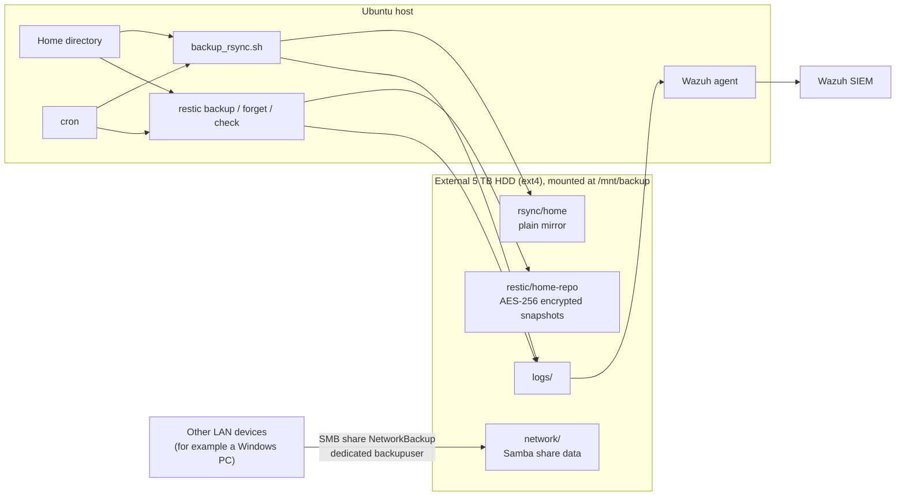

# Backup Lab Architecture

This is a **legacy portfolio project**. This document shows how the pieces built across the six implementation phases fit together. Step-by-step instructions are in [`docs/`](docs/).

## Overview

One external 5 TB HDD, mounted at `/mnt/backup`, holds three kinds of copy: a plain rsync mirror, an encrypted Restic repository and a Samba share for other devices. Cron drives the schedule and the Wazuh agent turns backup logs into alerts.

## Components

| Phase | Component | Behaviour |
|---|---|---|
| 1 | Storage | GPT, single ext4 partition, mounted at `/mnt/backup` by UUID in `fstab` with `nofail`, so the server still boots when the drive is absent |
| 2 | rsync mirror | `backup_rsync.sh` runs nightly at 02:00 from cron. It first checks that `/mnt/backup` is mounted, then mirrors the home directory with `--delete` (excluding caches and trash) and writes a timestamped log |
| 3 | Samba share | `NetworkBackup` is served to LAN devices through a dedicated `backupuser` account with no shell and no access beyond the share |
| 4 | Restic | AES-256 encrypted, deduplicated snapshots in `restic/home-repo`. Retention: 7 daily, 4 weekly, 3 monthly, then prune. The repository password sits in a root-restricted password file for unattended runs |
| 5 | Verification | `restic check` runs weekly (Sundays 02:30). A restore test deleted a directory tree and recovered it from a snapshot |
| 6 | Monitoring | The Wazuh agent reads four named log files. A custom rule (`100200`, level 7) raises an alert when the backup script logs a failure |

## Scheduled jobs

| Job | Cadence |
|---|---|
| rsync mirror | Nightly at 02:00 |
| Restic backup | Nightly |
| Restic forget and prune | Nightly |
| Restic integrity check | Weekly, Sunday 02:30 |

## Recovery objectives validated

- **RPO: 24 hours.** Backups run nightly.
- **RTO: under 1 hour.** Measured in the restore test: locating the snapshot and restoring a full directory tree.

## Design decisions

- **Encrypt on top of the mirror.** rsync copies are plain, so Restic adds encryption at rest and point-in-time recovery.
- **Guard before writing.** The script aborts when the drive is not mounted rather than filling the mount-point directory on the system disk.
- **Dedicated Samba account.** The network share uses its own no-shell account instead of the server login.
- **Named log files for Wazuh.** A wildcard `*.log` location flooded the agent's event queue ([incident report](docs/INCIDENT-REPORT.md)), so each log is listed explicitly.
- **Treat backup health as a monitored control.** Failures generate alerts instead of relying on manual checks.

## Known limitations

- **All tiers share one physical drive.** The mirror, the encrypted repository and the network copy all live under `/mnt/backup`, so one drive failure or theft affects every copy. Encryption covers only the Restic repository. There is no off-site copy.
- rsync can exit with code 23 on root-owned files inside Docker volumes. This is documented as an accepted limitation.
- The Restic password file's ownership caused three silent failures in the original build ([incident report](docs/INCIDENT-REPORT.md)).
- Losing the Restic password makes those backups unrecoverable.

## Related documents

[Phase 1](docs/PHASE1-mount-hdd.md) · [Phase 2](docs/PHASE2-rsync-cron.md) · [Phase 3](docs/PHASE3-samba-share.md) · [Phase 4](docs/PHASE4-restic-encryption.md) · [Phase 5](docs/PHASE5-verify-restore.md) · [Phase 6](docs/PHASE6-wazuh-integration.md) · [Incident report](docs/INCIDENT-REPORT.md)
